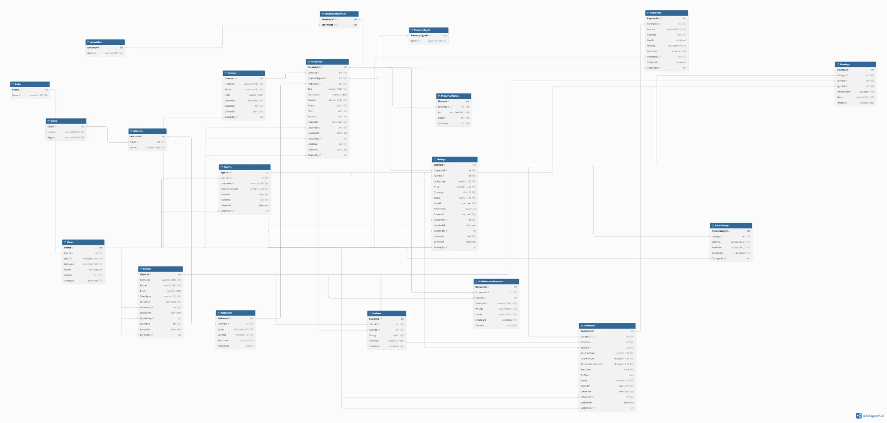

# RealEstateManagement

Система управління нерухомістю: облік об'єктів, оголошення про продаж і оренду, перегляди, договори, платежі.

- **ЛР1** — реляційна БД на MS SQL Server (20 таблиць, процедури, функції, тригери, View, індекси) і ASP.NET Core Web API з патернами Repository + Unit of Work. Звіт: [docs/lab1-report.md](docs/lab1-report.md).
- **ЛР2** — каталог оголошень у MongoDB, той самий каталог у SQL, порівняння швидкодії, базові запити Redis.



## Технології

| | |
|---|---|
| СУБД | Microsoft SQL Server 2025 (LocalDB для ЛР1, Docker-контейнер для тестів швидкодії ЛР2) |
| Застосунок | .NET 10, ASP.NET Core Web API, Dapper, Swagger UI |
| Тести | xUnit (інтеграційні, на LocalDB), SQL-перевірки в `sql/99_tests.sql` |
| NoSQL (ЛР2) | MongoDB 8.0, Redis 7.4 у Docker Compose |

## Швидкий старт (ЛР1)

Потрібно: Windows, .NET SDK 10, SQL Server LocalDB, `sqlcmd`.

```powershell
.\deploy.ps1 -Test                                           # створити БД, заповнити даними, прогнати 9 SQL-перевірок
dotnet test                                                  # 4 інтеграційні тести Unit of Work
dotnet run --project src\RealEstate.Api --launch-profile http
```

Swagger UI: http://localhost:5118/swagger. Запити на запис потребують заголовок `X-User-Id` (1–5, користувачі з тестових даних).

## Структура

```
docs/
  lab1-report.md         звіт ЛР1
  requirements.md        вимоги до системи
  schema.dbml            ER-схема для dbdiagram.io
  er-diagram.webp        ER-діаграма
  nosql-overview.md      ЛР2: види NoSQL, що і чому виносимо
  redis.md               ЛР2: базові запити Redis
  benchmarks/            ЛР2: сирі результати тестів швидкодії
sql/
  00–07                  створення БД, схема, функції, View, процедури, тригери, індекси, дані
  08_catalog.sql         ЛР2: SQL-реалізація каталогу (EAV-атрибути, vw_ListingCards, sp_ListingCard_Create)
  99_tests.sql           перевірки бізнес-логіки
  bench_indexed_view.sql ЛР2: indexed view для експерименту зі швидкодією
src/RealEstate.Api/      Web API: Controllers, Data (Unit of Work, Repositories), Models
tests/RealEstate.Tests/  інтеграційні тести
benchmarks/              ЛР2: генератор даних і тест швидкодії SQL Server vs MongoDB vs Redis
redis/                   ЛР2: демо-команди Redis
deploy.ps1               розгортання БД
docker-compose.yml       ЛР2: MongoDB, SQL Server, Redis
```

## ЛР1: відповідність завданню

| Пункт | Реалізація |
|---|---|
| 1. Схема БД | [docs/er-diagram.webp](docs/er-diagram.webp), [docs/schema.dbml](docs/schema.dbml) |
| 2. ≥ 15 сутностей | 20 таблиць — [sql/01_schema.sql](sql/01_schema.sql) |
| 3. Вимоги, soft delete, аудит | [docs/requirements.md](docs/requirements.md); soft delete на 5 таблицях, `UpdatedAt/UpdatedBy` на 5 таблицях |
| 4. Реалізація в СУБД | MS SQL Server, скрипти [sql/](sql), [deploy.ps1](deploy.ps1) |
| 5. ≥ 10 серверних об'єктів | 26: 4 функції, 6 View, 11 процедур, 5 тригерів |
| 6. ≥ 2 типи індексів | clustered, unique, filtered, composite + INCLUDE, columnstore — [sql/06_indexes.sql](sql/06_indexes.sql) |
| 7. Repository + Unit of Work | [src/RealEstate.Api/Data](src/RealEstate.Api/Data); демо — `POST /api/deals` |

Деталі — у [звіті](docs/lab1-report.md).

## ЛР2: NoSQL

Потрібно додатково: Docker Desktop.

```powershell
docker compose up -d                 # MongoDB :27018, SQL Server :14333, Redis :6379
.\benchmarks\run.ps1                 # тест швидкодії на 10k / 100k / 1M оголошень (-Scales 10000 для швидкої перевірки)
.\redis\run-demo.ps1                 # базові запити Redis
```

| Пункт | Де |
|---|---|
| 1–2. Види NoSQL, що виносимо і чому | [docs/nosql-overview.md](docs/nosql-overview.md) |
| 3. MongoDB: колекція `listingCards` | [MongoStore.cs](benchmarks/RealEstate.Benchmarks/MongoStore.cs), приклад документа [sample-card.json](docs/benchmarks/sample-card.json) |
| 4. Те саме в SQL (14 таблиць) | [sql/08_catalog.sql](sql/08_catalog.sql), [SqlStore.cs](benchmarks/RealEstate.Benchmarks/SqlStore.cs) |
| 5. Тест швидкодії | сирі результати [docs/benchmarks/](docs/benchmarks) |
| 6. Redis (key-value) | [docs/redis.md](docs/redis.md), [redis/demo.redis](redis/demo.redis) |
