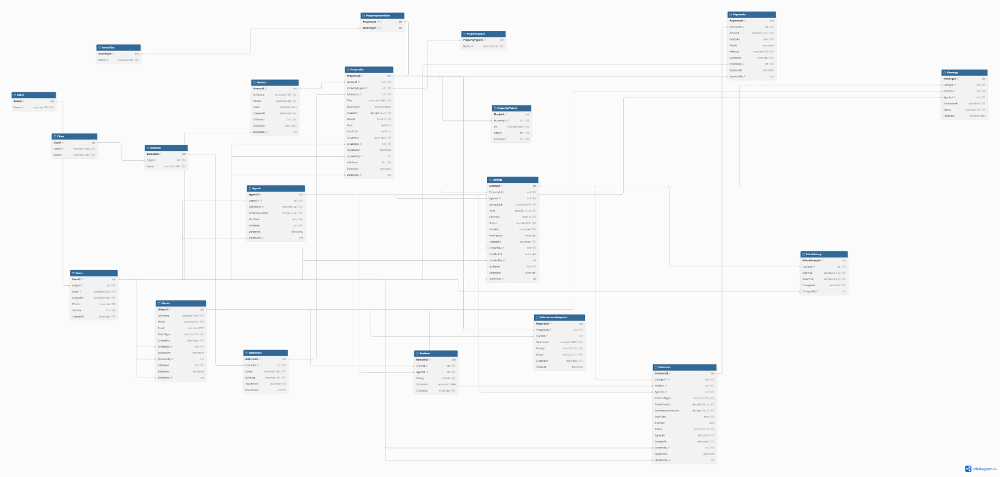

# Lab 1 Report

**Topic:** Real Estate Management System — design and implementation of a relational database, server-side logic, and data access from code via Repository + Unit of Work.

**Author:** Yurii Saplyukov
**DBMS:** Microsoft SQL Server 2025 (LocalDB)
**Code:** C# / .NET 10, ASP.NET Core Web API, Dapper

## Contents
1. [Domain and requirements](#1-domain-and-requirements)
2. [Database schema](#2-database-schema)
3. [Entities, soft delete and audit](#3-entities-soft-delete-and-audit)
4. [Implementation in the DBMS](#4-implementation-in-the-dbms)
5. [Stored procedures, functions, triggers, views](#5-stored-procedures-functions-triggers-views)
6. [Indexes](#6-indexes)
7. [Repository + Unit of Work](#7-repository--unit-of-work)
8. [Testing](#8-testing)
9. [Conclusions](#9-conclusions)

---

## 1. Domain and requirements

The system serves a real estate agency: property records, sale and rent listings, viewings, contracts, payments, maintenance requests and client reviews.

**Roles:**
- **Admin** — manages reference data and users;
- **Manager** — oversees deals, payments, reports;
- **Agent** — maintains listings and viewings, signs contracts;
- **Owner**, **Client** — external parties (property owner, buyer/tenant).

**Key requirements:**
1. A property has a type, an address (city → district → address), area, rooms, amenities and photos.
2. A listing is for sale or rent, with a price, a responsible agent and a status `Active / Reserved / Closed`.
3. Every price change goes to the price history automatically.
4. A contract is signed for an active listing; the listing is closed and the agent's commission is calculated automatically.
5. Contract payments: schedule and actual payment, debt and overdue tracking; a sale contract is completed automatically once fully paid.
6. Properties, listings, clients, owners and agents are never physically deleted (soft delete).
7. Key entities store the date and the author of the last change.
8. The application accesses the database **only** through stored procedures (writes) and views / table-valued functions (reads).

Full description — [requirements.md](requirements.md).

## 2. Database schema

The ER diagram was built in [dbdiagram.io](https://dbdiagram.io) from [schema.dbml](schema.dbml) (paste it into dbdiagram.io for an interactive view).



**Relationship types:**

| Relationship | Type | Example |
|---|---|---|
| Users → Agents | 1:1 | an agent is a user with a profile (license, commission rate); `UQ_Agents_User` |
| Listings → Contracts | 1:1 | one listing — at most one contract; `UQ_Contracts_Listing` |
| Properties ↔ Amenities | M:N | via the `PropertyAmenities` table with a composite PK |
| Cities → Districts → Addresses → Properties | 1:N (chain) | normalized address |
| Properties → Listings, Listings → PriceHistory, Contracts → Payments | 1:N | |
| Users → `CreatedBy / UpdatedBy / DeletedBy` columns | 1:N | author of a change in the audit columns |

All foreign keys have no cascading delete (`NO ACTION`): related data cannot be deleted physically, soft delete is used instead.

## 3. Entities, soft delete and audit

**20 tables** (the assignment requires at least 15):

| Group | Tables |
|---|---|
| Users | `Roles`, `Users`, `Agents` |
| Deal parties | `Owners`, `Clients` |
| Geography | `Cities`, `Districts`, `Addresses` |
| Properties | `PropertyTypes`, `Properties`, `Amenities`, `PropertyAmenities`, `PropertyPhotos` |
| Listings | `Listings`, `PriceHistory`, `Viewings` |
| Deals | `Contracts`, `Payments` |
| Maintenance | `MaintenanceRequests`, `Reviews` |

**Soft delete** (`IsDeleted bit`, `DeletedAt`, `DeletedBy` → `Users`): `Agents`, `Owners`, `Clients`, `Properties`, `Listings`.

**Change audit** (`CreatedAt`, `CreatedBy`, `UpdatedAt`, `UpdatedBy` → `Users`): `Clients`, `Properties`, `Listings`, `Contracts`, `Payments`.

**Optimistic locking:** `Listings.RowVersion` (`rowversion`) — the price-change procedure rejects the change if another user modified the row in the meantime.

**Integrity constraints:** `CHECK` (price > 0, area > 0, rating 1–5, `EndDate >= StartDate`, allowed statuses and types), `UNIQUE`, `DEFAULT`.

## 4. Implementation in the DBMS

The scripts in [`sql/`](../sql) run in order via [`deploy.ps1`](../deploy.ps1), which recreates the database from scratch:

| Script | Contents |
|---|---|
| `00_create_db.sql` | creates the `RealEstateDb` database |
| `01_schema.sql` | 20 tables, PK, FK, CHECK, DEFAULT, UNIQUE |
| `02_functions.sql` | scalar functions |
| `03_views.sql` | views and table-valued functions |
| `04_procedures.sql` | stored procedures |
| `05_triggers.sql` | triggers |
| `06_indexes.sql` | indexes |
| `07_seed.sql` | test data (contracts and payments go through procedures so the triggers fire) |
| `99_tests.sql` | automated business logic checks |

```powershell
.\deploy.ps1 -Test
```

## 5. Stored procedures, functions, triggers, views

**26 objects** in total (at least 10 required).

### Functions (4)

| Function | Kind | Purpose |
|---|---|---|
| `fn_CalcCommission(@Amount, @Rate)` | scalar | agent commission on the deal amount |
| `fn_GetContractDebt(@ContractId)` | scalar | remaining debt: contract amount minus paid payments |
| `fn_PropertiesByCity(@CityId)` | table-valued (inline) | active properties in a city |
| `fn_ListingsByAgent(@AgentId)` | table-valued (inline) | an agent's listings |

### Views (6)

| View | Shows |
|---|---|
| `vw_ActiveProperties` | non-deleted properties with type, address and owner |
| `vw_ActiveListings` | non-deleted listings with property, city and agent |
| `vw_ContractDetails` | contracts with parties, paid amount and debt |
| `vw_PaymentsByContract` | payments with client and paid flag |
| `vw_OverduePayments` | unpaid payments past their due date |
| `vw_AgentPerformance` | agent metrics: listings, deals, commission, rating |

### Stored procedures (11)

| Procedure | What it does |
|---|---|
| `sp_Property_Create / Update` | create and update a property with audit |
| `sp_Property_SoftDelete` | soft delete a property together with its listings; not allowed with an active contract |
| `sp_Listing_Create` | new listing; two active listings of the same type for one property are not allowed |
| `sp_Listing_UpdatePrice` | price change with a `RowVersion` check |
| `sp_Listing_SoftDelete` | soft delete a listing |
| `sp_Client_Create / SoftDelete` | clients |
| `sp_Contract_Create` | contract for an active listing: type and agent come from the listing, commission via `fn_CalcCommission`, the listing is closed |
| `sp_Payment_Register` | payment or scheduled payment; overpaying the debt is not allowed |
| `sp_Payment_MarkPaid` | mark a scheduled payment as paid |

Business rule violations are raised with `THROW` and codes: `50400` — invalid data, `50404` — not found, `50409` — state conflict. The Web API maps them to HTTP 400 / 404 / 409.

Procedures with several changes (`sp_Property_SoftDelete`, `sp_Contract_Create`) work both on their own and inside an application transaction: if a transaction is already open, they use `SAVE TRANSACTION`, so an error inside the procedure does not break the outer Unit of Work transaction.

### Triggers (5)

| Trigger | Event | Logic |
|---|---|---|
| `trg_Listings_PriceHistory` | AFTER UPDATE on `Listings` | on a price change, writes a row to `PriceHistory` (old/new price, author) |
| `trg_Properties_InsteadOfDelete` | INSTEAD OF DELETE on `Properties` | turns `DELETE` into a soft delete of the property and its listings |
| `trg_Listings_InsteadOfDelete` | INSTEAD OF DELETE on `Listings` | turns `DELETE` into a soft delete |
| `trg_Contracts_SetUpdatedAt` | AFTER UPDATE on `Contracts` | updates `UpdatedAt` on any contract change |
| `trg_Payments_CompleteContract` | AFTER INSERT, UPDATE on `Payments` | a sale contract becomes `Completed` when the debt reaches zero |

## 6. Indexes

| Type | Index | Purpose |
|---|---|---|
| Clustered | PK of every table | physical row order by key |
| Unique nonclustered | `UX_Users_Email`, `UX_Agents_LicenseNo` | unique login and license |
| Filtered unique | `UX_Clients_Phone_Active … WHERE IsDeleted = 0` | phone is unique only among non-deleted clients |
| Filtered nonclustered | `IX_Properties_Owner_Active`, `IX_Listings_Property_Active` (`WHERE IsDeleted = 0`) | queries touch only active rows, the index is smaller |
| Composite + INCLUDE (covering) | `IX_Listings_Status_Price (Status, Price) INCLUDE (PropertyId, AgentId, ListingType)` | search active listings by price range without touching the table |
| Nonclustered on FKs | 8 indexes (`IX_Contracts_Client`, `IX_Payments_Contract`, etc.) | fast JOINs and FK checks |
| Nonclustered columnstore | `NCCI_Payments (ContractId, Amount, DueDate, PaidAt)` | aggregate payment reports |

Index usage is demonstrated at the end of `99_tests.sql` with `SET STATISTICS IO ON`: each of the three sample queries reads 2 pages.

## 7. Repository + Unit of Work

The logically related chain of entities: **Property → Listing → Contract → Payment**.

```
Controller ──> IUnitOfWork ──┬── IPropertyRepository ──> vw_ActiveProperties, fn_PropertiesByCity / sp_Property_*
                             ├── IListingRepository  ──> vw_ActiveListings, fn_ListingsByAgent / sp_Listing_*
                             ├── IContractRepository ──> vw_ContractDetails / sp_Contract_Create
                             └── IPaymentRepository  ──> vw_PaymentsByContract, vw_OverduePayments / sp_Payment_*
                  one SqlConnection + one SqlTransaction shared by all repositories
```

- [`UnitOfWork.cs`](../src/RealEstate.Api/Data/UnitOfWork.cs) opens one connection and provides `BeginTransaction / Commit / Rollback`; an uncommitted transaction is rolled back on `Dispose`.
- Repositories ([`Data/Repositories`](../src/RealEstate.Api/Data/Repositories)) share the connection and the transaction of the UoW. **Reads** are only `SELECT`s from views / table-valued functions, **writes** are only `CommandType.StoredProcedure`. There are no direct queries to tables.
- The user for the audit columns is passed to every procedure as `@UserId` (in the API — from the `X-User-Id` header).

Demo — `POST /api/deals` ([`DealsController.cs`](../src/RealEstate.Api/Controllers/DealsController.cs)): four procedures in one transaction.

```csharp
uow.BeginTransaction();
try
{
    var propertyId = await uow.Properties.CreateAsync(request.Property, userId);
    var listingId  = await uow.Listings.CreateAsync(propertyId, request.Listing, userId);
    var contractId = await uow.Contracts.CreateAsync(listingId, request.Contract, userId);
    var paymentId  = await uow.Payments.RegisterAsync(contractId, request.Payment, userId);
    uow.Commit();
    ...
}
catch
{
    uow.Rollback();
    throw;
}
```

If any step fails (for example, `sp_Payment_Register` rejects an overpayment), all four writes are rolled back.

**API endpoints** (Swagger: `http://localhost:5118/swagger`):

| Method | Path | Action |
|---|---|---|
| GET | `/api/properties/{id}`, `/api/properties?cityId=` | a property / properties in a city |
| POST, PUT, DELETE | `/api/properties`, `/api/properties/{id}` | create, update, soft delete |
| GET | `/api/listings`, `/api/listings?agentId=`, `/api/listings/{id}` | listings |
| POST | `/api/properties/{id}/listings` | new listing |
| PUT | `/api/listings/{id}/price` | price change (with `RowVersion`) |
| DELETE | `/api/listings/{id}` | soft delete |
| POST | `/api/listings/{id}/contract` | contract |
| GET | `/api/contracts/{id}`, `/api/contracts/{id}/payments`, `/api/payments/overdue` | contract, payments, overdue payments |
| POST, PUT | `/api/contracts/{id}/payments`, `/api/payments/{id}/paid` | payment, mark paid |
| POST | `/api/deals` | a turnkey deal in one transaction |

## 8. Testing

**SQL checks** (`sql/99_tests.sql`, run inside a transaction with `ROLLBACK`, data is not changed) — 9/9 passed:

| # | What is checked |
|---|---|
| 1 | `DELETE FROM Properties` does not remove the row but soft deletes it (with `DeletedBy` from `SESSION_CONTEXT`) |
| 2 | `trg_Listings_PriceHistory` records the price history with the author |
| 3 | the procedure fills `UpdatedAt / UpdatedBy` |
| 4 | `sp_Contract_Create` closes the listing, commission = 3% of the amount; full payment → contract `Completed` |
| 5 | `fn_GetContractDebt`, `vw_OverduePayments` |
| 6 | an overpayment is rejected with code 50400 |
| 7 | a stale `RowVersion` is rejected with code 50409 |
| 8 | `fn_PropertiesByCity`, `fn_ListingsByAgent` |
| 9 | a procedure error inside an outer transaction does not break it (savepoint) |

**Integration tests** (`tests/RealEstate.Tests`, xUnit, `dotnet test`) — 4/4 passed:

| Test | What it checks |
|---|---|
| `Deal_Commit_SavesAllEntities` | a deal of 4 entities is saved; the trigger completes the contract, debt 0, commission 30,000 |
| `Deal_FailsOnPayment_RollsBackEverything` | failure at the payment step → after `Rollback` there is no property, listing or contract in the database |
| `SoftDelete_HidesPropertyAndItsListings` | soft delete hides the property and its listings from the views |
| `UpdatePrice_WithStaleRowVersion_Throws409` | optimistic locking |

**Manual API check:** `POST /api/deals` → 201; a deal with an error → 400 and nothing appears in the database; a request without `X-User-Id` → 400; deleting a non-existent property → 404.

## 9. Conclusions

1. A normalized schema of 20 tables was designed with all relationship types (1:1, 1:N, M:N) and integrity constraints at the database level.
2. Soft delete is implemented on two levels: procedures (`sp_*_SoftDelete`) and `INSTEAD OF DELETE` triggers, so even a plain `DELETE` does not remove data. Change audit is filled by procedures and triggers.
3. Business rules (commission, closing the listing, overpayment ban, automatic contract completion, price history) run in the database and do not depend on the client.
4. Six kinds of indexes are tailored to specific queries; filtered indexes work together with soft delete.
5. Repository + Unit of Work provides atomic operations over several entities: all queries from code go through procedures and views, and several procedures run in one transaction with a full rollback on error.
